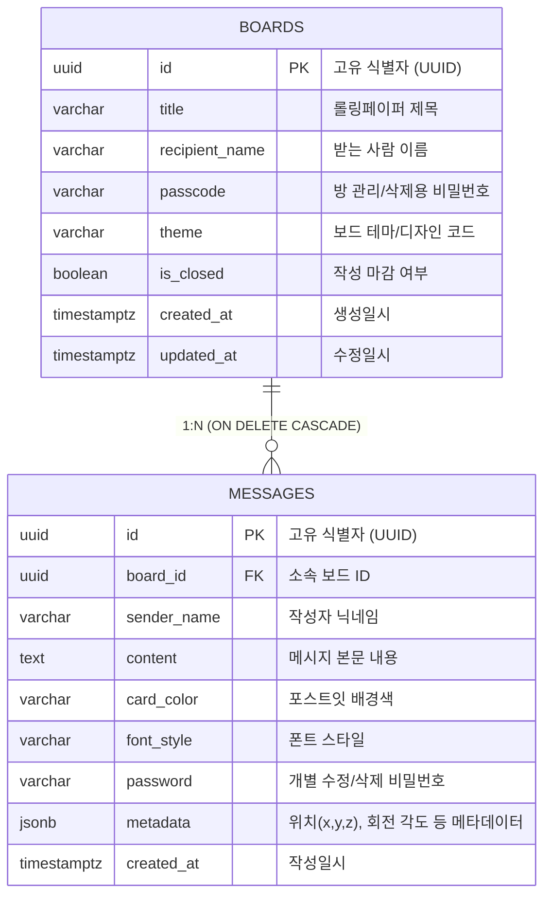

# 💌 디지털 롤링페이퍼 (Digital Rolling Paper)

<div align="center">


<br/>

**별도의 백엔드 API 서버 없이, Supabase(BaaS)와 Realtime 기능을 활용하여 구축한 감성 디지털 롤링페이퍼 웹 서비스입니다.**  
생일, 졸업, 퇴사, 기념일 등 소중한 순간에 링크 하나로 여러 방문자가 실시간으로 알록달록한 포스트잇 메시지를 남길 수 있습니다.

</div>

---

## ✨ 주요 기능 (Key Features)

- 📌 **롤링페이퍼 보드(방) 생성 및 전환**:
  - 받는 사람 이름, 축하 제목, 테마를 지정하여 새로운 롤링페이퍼 방을 쉽게 개설할 수 있습니다.
  - 상단 보드 선택창을 통해 개설된 다양한 롤링페이퍼 공간을 자유롭게 이동할 수 있습니다.

- 🎨 **감성적인 포스트잇 커스터마이징**:
  - **다양한 컬러 팔레트**: 노랑(Yellow), 핑크(Pink), 하늘(Sky Blue), 연두(Green), 보라(Purple)
  - **감성 글꼴 선택**: 나눔손글씨 펜체, Gaegu(개구쟁이체), Noto Sans(고딕), 나눔명조체
  - 자연스러운 코르크 칠판 느낌을 위해 포스트잇마다 고유한 각도와 핀 효과를 제공합니다.

- ⚡ **Supabase Realtime 실시간 동기화**:
  - 새로고침할 필요 없이, 누군가 새 메시지를 남기면 보드 화면에 실시간으로 포스트잇이 즉시 렌더링됩니다.
  - 메시지 등록 시 화려한 폭죽(Confetti) 효과로 축하 분위기를 더합니다.

- 🛡️ **PostgreSQL 기반 RLS(행 수준 보안)**:
  - 서버리스 환경에서도 데이터 무결성과 접근 제어를 보장합니다.
  - 마감된 보드(`is_closed = true`)에는 프론트엔드를 우회하더라도 신규 메시지 등록이 DB 레벨에서 차단됩니다.

---

## 🗄️ 데이터베이스 아키텍처 (Database Design)

### ERD (Entity Relationship Diagram)



### 테이블 구성
1. **`boards`**: 롤링페이퍼 방 테이블
2. **`messages`**: 개별 포스트잇 메시지 테이블 (`board_id` 외래키 및 `ON DELETE CASCADE` 적용)

---

## 🚀 빠른 시작 (Getting Started)

### 1. 저장소 복제 (Clone)
```bash
git clone https://github.com/jihunyangAI/roll_paper.git
cd roll_paper
```

### 2. 웹 앱 실행
단일 파일(SPA)로 제작되어 별도의 복잡한 빌드 과정 없이 바로 실행할 수 있습니다.

#### 방법 A: Python 로컬 서버 실행
```bash
python -m http.server 3000
```
브라우저에서 `http://localhost:3000` 접속

#### 방법 B: Node.js `serve` 패키지 사용
```bash
npx serve -l 3000
```

#### 방법 C: 직접 실행
`index.html` 파일을 브라우저로 직접 더블클릭하여 열어도 정상 작동합니다.

---

## 🛠️ 자체 Supabase 프로젝트에 연결하기

본 프로젝트의 [`schema.sql`](./schema.sql)을 복사하여 본인의 Supabase 대시보드 **SQL Editor**에 실행한 후, [`index.html`](./index.html)의 상단 설정을 수정해 주세요:

```javascript
// index.html
const SUPABASE_URL = "YOUR_SUPABASE_PROJECT_URL";
const SUPABASE_ANON_KEY = "YOUR_SUPABASE_ANON_KEY";
```

---

## 📂 프로젝트 구조

```text
├── index.html        # 단일 페이지 롤링페이퍼 웹 애플리케이션
├── schema.sql        # Supabase DDL (테이블, 인덱스, RLS, Realtime)
├── .gitignore        # Git 제외 설정
└── README.md         # 프로젝트 문서
```

---

## 📄 라이선스 (License)

This project is licensed under the MIT License - see the [LICENSE](LICENSE) file for details.
